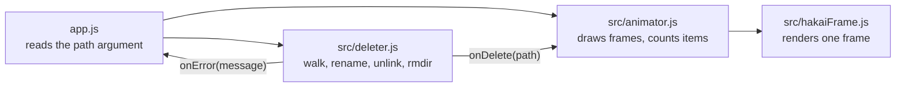

<h1 align="center">Hakai 破壊</h1>

<p align="center">
  
</p>

<p align="center">
  <b>Deletes folders and files that the system refuses to remove, in style.</b>
</p>

<p align="center">
  <a href="https://github.com/juninmd/Hakai/actions/workflows/validate.yml"></a>
  <a href="https://www.npmjs.com/package/hakai"></a>
  <a href="package.json"></a>
</p>

---

## Why it exists

On older Node.js versions, `node_modules` folders end up with very long paths. On Windows, the system refuses to delete them. Hakai works around this by renaming subfolders to shorter paths before removing them.

## Features

- Removes files and folders with long paths.
- Accepts a single file or a whole folder.
- Hakai energy animation in the terminal, with a counter of destroyed items.
- No animation when the output is not a terminal (pipes, logs, CI).

## How it works



For each subfolder, `src/deleter.js` renames it to `<root><n>` (a short sibling path of the target), empties it and removes it. Errors are collected and printed to stderr after the run.

## Installation

```bash
yarn global add hakai
# or
npm install -g hakai
# or, without installing
npx hakai "D:\My Folder"
```

Hakai runs on Node.js; the test suite needs Node.js 18 or later.

## Usage

```bash
hakai "D:\My Folder"
```

> Use quotes when the path contains spaces.

Running without a path prints the usage line (output is in Portuguese):

```text
$ hakai
[HAKAI] Utilize `$ hakai "<caminho>"` (Não se esqueça das aspas)
```

When the run ends it prints `[HAKAI] Exclusão concluída: <path>`. Hakai has no flags or environment variables.

## Known limitations

- Deletion is permanent: nothing goes to the recycle bin and there is no confirmation prompt.
- Exit code is always `0`, including when the path does not exist or an item fails to delete; failures are printed to stderr.
- Messages are in Portuguese only.

## Development

```bash
npm test
```

Tests use `node:test`, which ships with Node.js 18 or later.

## License

MIT, as declared in [`package.json`](package.json).

---

<p align="center"><sub>Hakai is the destruction power wielded by the Gods of Destruction in Dragon Ball Super.</sub></p>
