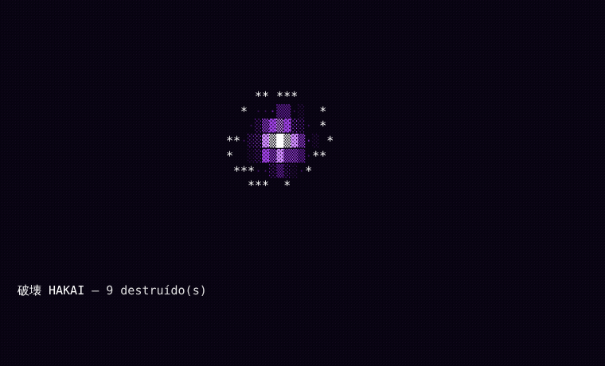

<h1 align="center">Hakai 破壊</h1>

<p align="center">
  
</p>

<p align="center">
  <b>Deletes folders and files that the system refuses to remove, in style.</b>
</p>

---

## Why it exists

On older Node.js versions, `node_modules` folders end up with very long paths. On Windows, the system refuses to delete them. Hakai works around this by renaming subfolders to shorter paths before removing them.

## Features

- Removes files and folders with long paths.
- Accepts a single file or a whole folder.
- Hakai energy animation in the terminal, with a counter of destroyed items.
- No animation when the output is not a terminal (pipes, logs, CI).

## Installation

```bash
yarn global add hakai
```

## Usage

```bash
hakai "D:\My Folder"
```

> Use quotes when the path contains spaces.

## Development

```bash
npm test
```

Tests use `node:test`, which ships with Node.js 18 or later.

---

<p align="center"><sub>Hakai is the destruction power wielded by the Gods of Destruction in Dragon Ball Super.</sub></p>
